# API Security Assessment & Automated VAPT Framework

[](https://www.python.org/)
[](https://flask.palletsprojects.com/)
[](https://owasp.org/www-project-api-security/)
[](https://portswigger.net/burp)
[](#retesting--false-positive-reduction-suite)
[](#ethical-scope-guard--safety-controls)

An enterprise-grade, end-to-end **API Vulnerability Assessment and Penetration Testing (VAPT) Framework** designed to assess, exploit, document, and verify remediations for modern RESTful APIs. 

The framework pairs an automated multi-threaded Python security scanner with **ShopVault API**—a fully functional, dual-mode (Vulnerable vs. Hardened) Flask & SQLite testbed—delivering automated vulnerability detection, raw RFC-compliant HTTP Proof of Concepts (PoC) for **Burp Suite Repeater**, and automated **Retest Verification** to eliminate false positives.

---

## Visual Previews & Project Architecture

### Security Assessment Dashboard Preview


### System Architecture & Data Flow

```mermaid
flowchart LR
    subgraph VAPT_Framework["Automated VAPT Framework (Python)"]
        direction TB
        CLI["CLI Entry Point (vapt_cli.py)"]
        SCOPE["Scope Guard (Localhost Whitelist)"]
        ENGINE["Scan Orchestrator (engine.py)"]
        REQ["HTTP Client & Burp Proxy Router"]
        
        subgraph Modules["Security Assessment Modules"]
            M1["JWT & Auth Scanner"]
            M2["BOLA / IDOR Scanner"]
            M3["BFLA Admin Escalation"]
            M4["Mass Assignment Scanner"]
            M5["SQL Injection Scanner"]
            M6["OS Command Injection"]
            M7["Misconfiguration & CORS"]
            M8["Rate Limiting Scanner"]
        end
        
        REPORTER["Reporting Engine (HTML, JSON, MD)"]
        RETEST["Retesting & Verification Engine"]
    end

    subgraph ProxyLayer["Manual Verification Layer"]
        BURP["Burp Suite Proxy (127.0.0.1:8080)"]
    end

    subgraph TargetAPI["ShopVault REST API (Flask & SQLite)"]
        API["API Endpoints (/documents, /orders, /users, /admin, /tools)"]
        MODE{"Security Mode"}
        VULN["Vulnerable Mode (Flaws Active)"]
        SEC["Hardened SECURE Mode (Remediated)"]
    end

    CLI --> SCOPE --> ENGINE
    ENGINE --> Modules
    Modules --> REQ
    REQ -. Optional Upstream Proxy .-> BURP
    REQ --> API
    BURP --> API
    API --> MODE
    MODE --> VULN
    MODE --> SEC
    Modules --> REPORTER
    REPORTER --> RETEST
```




---

## OWASP API Security Top 10 Coverage Matrix

| Vulnerability ID | OWASP API Category | Vulnerability Title | Severity | CVSS v3.1 | Endpoint | Verified Fix |
|:---|:---|:---|:---:|:---:|:---|:---:|
| `VAPT-AUTH-001` | **API2:2023** - Broken Authentication | JWT Signature Bypass via `alg: none` | **CRITICAL** | `9.8` | Protected Endpoints | Verified |
| `VAPT-AUTH-002` | **API2:2023** - Broken Authentication | Weak / Guessable HMAC Secret (`secret123`) | **HIGH** | `8.5` | `/api/v1/auth/login` | Verified |
| `VAPT-BOLA-001` | **API1:2023** - Broken Object Level Auth | Cross-Tenant Document Exfiltration | **CRITICAL** | `8.6` | `/api/v1/documents/{id}` | Verified |
| `VAPT-BOLA-002` | **API1:2023** - Broken Object Level Auth | Unauthorized Order & Shipping Address Leakage | **HIGH** | `7.7` | `/api/v1/orders/{id}` | Verified |
| `VAPT-BOLA-003` | **API1:2023** - Broken Object Level Auth | Insecure Direct Object Reference (IDOR) | **HIGH** | `7.5` | `/api/v1/users/{id}/profile` | Verified |
| `VAPT-BFLA-001` | **API5:2023** - Broken Function Level Auth | Unrestricted Administrative User Management | **CRITICAL** | `8.8` | `/api/v1/admin/users` | Verified |
| `VAPT-BFLA-002` | **API5:2023** - Broken Function Level Auth | Unauthorized Database Backup Exfiltration | **CRITICAL** | `8.8` | `/api/v1/admin/export-db` | Verified |
| `VAPT-PROP-001` | **API3:2023** - Broken Object Property Auth | Excessive Data Exposure (Password Hashes & SSN) | **HIGH** | `7.5` | `/api/v1/users/{id}/profile` | Verified |
| `VAPT-PROP-002` | **API3:2023** - Broken Object Property Auth | Mass Assignment Privilege Escalation (`role: admin`) | **HIGH** | `8.5` | `/api/v1/users/{id}/profile` | Verified |
| `VAPT-SQLI-001` | **CWE-89** - Injection Flaws | UNION-Based SQL Injection | **CRITICAL** | `9.8` | `/api/v1/products/search` | Verified |
| `VAPT-CMD-001` | **CWE-78** - Injection Flaws | Remote OS Command Injection | **CRITICAL** | `9.8` | `/api/v1/tools/ping` | Verified |
| `VAPT-MISC-001` | **API8:2023** - Security Misconfiguration | Permissive CORS with Wildcard / Credential Reflection | **HIGH** | `7.1` | `/api/v1/*` | Verified |
| `VAPT-MISC-002` | **API8:2023** - Security Misconfiguration | Missing Standard Defense-in-Depth Headers | **LOW** | `3.7` | Global Headers | Verified |
| `VAPT-MISC-003` | **API8:2023** - Security Misconfiguration | Server Framework Fingerprint Leakage | **INFO** | `2.0` | Global Headers | Verified |
| `VAPT-MISC-004` | **API8:2023** - Security Misconfiguration | Disclosed Debug Configuration & Secret Keys | **HIGH** | `8.2` | `/api/v1/tools/debug/config` | Verified |
| `VAPT-RATE-001` | **API4:2023** - Unrestricted Resource Cons. | Missing Authentication Rate Limiting | **MEDIUM** | `5.3` | `/api/v1/auth/login` | Verified |

---

## Key Capabilities & Engineering Highlights

1. **Dual-User Cross-Tenant Authorization Testing (BOLA/IDOR):**
   - Automatically provisions and authenticates dual identities (Victim: `alice`, Attacker: `bob`).
   - Swaps Bearer tokens across private objects (`/documents/1`, `/orders/1`, `/users/1/profile`), detects tenant isolation violations, and captures unauthorized data exfiltration proofs.

2. **Full JWT Cryptographic Exploit Suite:**
   - Detects `alg: none` header bypass vulnerabilities and crafts unsigned administrative tokens on the fly.
   - Performs offline dictionary attacks against symmetric HMAC-SHA256 tokens using embedded wordlists.
   - Validates expiration claim enforcement (`exp`) and token replay resistance.

3. **Multi-Vector Injection Testing (SQLi & Command Injection):**
   - Extracts complete database contents (`users`, credentials, emails) via dynamic UNION SELECT payloads in search endpoints.
   - Validates OS command injection in diagnostic endpoints (`ping?host=127.0.0.1 & whoami`) without destructive system alterations.

4. **Burp Suite Native Workflow & Proxy Routing:**
   - Command-line switch `--proxy http://127.0.0.1:8080` transparently routes all automated scanner requests through Burp Suite.
   - Pre-generated RFC 7230 `.http` request files in `burp_suite/poc_requests/` can be pasted directly into **Burp Repeater** for manual validation.

5. **Automated Retesting & False Positive Verification Engine:**
   - Loads a baseline assessment report (`reports/vapt_baseline.json`) and compares it against a post-remediation retest (`reports/vapt_retest.json`).
   - Categorizes every finding as `RESOLVED`, `PERSISTENT`, or `NEW`.
   - Computes an automated remediation score (**100% verified resolution**) and renders an interactive HTML audit certificate.

6. **Ethical Scope Guard & Safety Controls:**
   - Embedded `TargetScopeValidator` ensures the scanner strictly operates against `localhost`, `127.0.0.1`, `::1`, or explicitly whitelisted targets defined in `config.yaml`.
   - Immediately aborts execution if an external or non-whitelisted target is supplied, preventing accidental or unauthorized scanning.

---

## Directory Structure

```text
API Security Assessment & Automated VAPT Framework/
|-- api_testbed/                   # ShopVault Vulnerable & Hardened Flask REST API
|   |-- app.py                     # Flask factory with dual-mode (VULNERABLE / SECURE)
|   |-- config.py                  # API settings & JWT secret configuration
|   |-- database.py                # SQLite schema and initialization
|   |-- seed_data.py               # Database seeder with realistic test records
|   `-- routes/                    # Modular API blueprints
|       |-- auth.py                # Authentication & JWT issuance
|       |-- users.py               # Profile management & Mass Assignment
|       |-- documents.py           # Confidential documents (BOLA target)
|       |-- orders.py              # Customer order receipts (BOLA target)
|       |-- products.py            # Catalog & Search (SQL Injection target)
|       |-- admin.py               # Administrative operations (BFLA target)
|       `-- tools.py               # Diagnostics ping (Command Injection target)
|
|-- vapt_framework/                # Core Automated Security Testing Framework
|   |-- core/
|   |   |-- scope.py               # Ethical scope validator & boundary guards
|   |   |-- requester.py           # HTTP client with Burp Suite proxy routing
|   |   |-- vulnerability.py       # Vulnerability data model (CVSS, CWE, PoC)
|   |   |-- engine.py              # Scan orchestrator and progress tracker
|   |   `-- config.py              # Framework configuration manager
|   |-- modules/                   # OWASP API Security assessment modules
|   |   |-- auth_jwt.py            # JWT none-alg, weak secret & auth scanner
|   |   |-- bola.py                # Dual-token BOLA / IDOR assessment
|   |   |-- bfla.py                # Privilege escalation & admin access tests
|   |   |-- mass_assignment.py     # Property level authorization & data exposure
|   |   |-- injection_sql.py       # SQL Injection scanner (UNION & error-based)
|   |   |-- injection_cmd.py       # Remote OS Command Injection scanner
|   |   |-- misconfig.py           # CORS, security headers & debug leakage
|   |   `-- rate_limit.py          # Burst authentication rate limiting tests
|   |-- reporting/
|   |   |-- generator.py           # Multi-format report builder (HTML, JSON, MD)
|   |   |-- html_template.py       # Interactive cybersecurity report dashboard
|   |   `-- retest_engine.py       # Baseline vs Retest comparison engine
|   `-- wordlists/
|       |-- jwt_secrets.txt        # Common HMAC secrets dictionary
|       `-- sqli_payloads.txt      # SQL injection verification strings
|
|-- burp_suite/                    # Burp Suite integration & manual validation
|   |-- BURP_SUITE_WALKTHROUGH.md  # Step-by-step Burp Repeater & Intruder guide
|   `-- poc_requests/              # RFC 7230 raw HTTP request files for Repeater
|       |-- 01_bola_idor.http
|       |-- 02_jwt_alg_none.http
|       |-- 03_mass_assignment.http
|       |-- 04_bfla_admin_bypass.http
|       |-- 05_sqli_search.http
|       `-- 06_cmd_injection.http
|
|-- reports/                       # Generated scan outputs and audit certificates
|   |-- vapt_baseline.html         # Interactive HTML report (Initial Assessment)
|   |-- vapt_baseline.json         # Machine-readable JSON report
|   |-- vapt_baseline.md           # Executive Markdown summary
|   |-- vapt_retest.html           # Retest scan dashboard
|   |-- retest_verification_report.html # Remediation audit certificate
|   `-- retest_verification_report.json # Retest comparison metrics
|
|-- assets/                        # SVG diagrams and report preview graphics
|   |-- dashboard_preview.svg
|   `-- architecture_diagram.svg
|
|-- config.yaml                    # Framework target, accounts, and proxy settings
|-- vapt_cli.py                    # Main CLI scanner entry point
|-- run_demo.py                    # One-click end-to-end demonstration script
|-- requirements.txt               # Python package dependencies
`-- README.md                      # Comprehensive documentation
```

---

## Windows Setup & Execution Guide

### 1. Prerequisites & Environment Setup

Open PowerShell or Command Prompt in the project directory:

```powershell
# Verify Python installation (Python 3.10+ recommended)
python --version

# (Optional) Create and activate a virtual environment
python -m venv venv
.\venv\Scripts\Activate.ps1

# Install required dependencies
pip install -r requirements.txt

# Seed the initial SQLite database with test accounts and confidential data
python -m api_testbed.seed_data
```

---

### 2. One-Click Demonstration (Assessment + Retesting)

To witness the entire penetration testing lifecycle in seconds—including starting the vulnerable API, running the automated baseline assessment, launching the hardened API, executing the retest verification, and proving 100% remediation:

```powershell
python run_demo.py
```

**Expected Demonstration Output:**
```text
========================================================================
  END-TO-END VAPT DEMONSTRATION & RETESTING VERIFICATION SUITE
========================================================================

[PHASE 1] Starting Vulnerable API Testbed...
[+] Vulnerable API running at http://127.0.0.1:5000

[PHASE 1] Executing Automated VAPT Security Assessment...
[*] Target Base URL : http://127.0.0.1:5000
[*] Scope Guard     : Active (Restricted to localhost / authorized)
[*] Proxy           : Disabled (Direct communication)

[*] Running: Authentication & JWT Security Scanner ... [!] 2 Vulnerability(s) Detected (0.10s)
    \-- [CRITICAL] JWT Signature Bypass via 'alg: none' Algorithm
    \-- [HIGH] Weak / Guessable JWT HMAC Secret Key
[*] Running: Broken Object Level Authorization (BOLA/IDOR) Scanner ... [!] 3 Vulnerability(s) Detected (0.04s)
    \-- [CRITICAL] Broken Object Level Authorization (BOLA) in Document Retrieval
    \-- [HIGH] Broken Object Level Authorization (BOLA) in Order Receipts
    \-- [HIGH] Insecure Direct Object Reference (IDOR) on User Profile Endpoint
[*] Running: Broken Function Level Authorization (BFLA) Scanner ... [!] 2 Vulnerability(s) Detected (0.01s)
    \-- [CRITICAL] Broken Function Level Authorization - Unrestricted Admin Access
    \-- [CRITICAL] Unauthorized Administrative Database Export Trigger
[*] Running: Object Property Level Authorization Scanner ... [!] 2 Vulnerability(s) Detected (0.03s)
    \-- [HIGH] Excessive Data Exposure in User Profile Response
    \-- [HIGH] Mass Assignment Enabling Privilege Escalation
[*] Running: SQL Injection Assessment Module ... [!] 1 Vulnerability(s) Detected (0.07s)
    \-- [CRITICAL] SQL Injection in Product Search Parameter ('q')
[*] Running: OS Command Injection Scanner ... [!] 1 Vulnerability(s) Detected (0.13s)
    \-- [CRITICAL] Remote OS Command Injection in Diagnostic Ping Utility
[*] Running: Security Misconfiguration Scanner ... [!] 4 Vulnerability(s) Detected (0.04s)
[*] Running: Unrestricted Resource Consumption & Rate Limiting ... [!] 1 Vulnerability(s) Detected (0.10s)

====================================================================
  VULNERABILITY ASSESSMENT SUMMARY
====================================================================
  Total Findings Discovered : 16
  Critical Risk             : 6
  High Risk                 : 7
  Medium Risk               : 1
  Low Risk                  : 1
  Informational             : 1
====================================================================

[PHASE 2] Starting Remediated SECURE API Testbed...
[+] Secure API running at http://127.0.0.1:5000 (Hardened Mode)
[*] Executing Automated Retest & Fix Verification Scan...
[+] All 8 modules Clean / Passed (0 Vulnerabilities Detected)

[PHASE 3] Calculating Remediation Rate & False Positive Reduction...
========================================================================
  VAPT ASSESSMENT & REMEDIATION VERIFICATION RESULTS
========================================================================
  Baseline Vulnerabilities Found : 16
  Remaining in Retest            : 0
  Successfully Remediated        : 16
  Remediation Rate               : 100.0%
  False Positive Reduction       : Verified (0 False Positives)
========================================================================
```

---

### 3. Manual Step-by-Step Execution

#### Step A: Run the Target API (Vulnerable Mode)
In **Terminal 1**:
```powershell
python -m api_testbed.app --port 5000 --reseed
```

#### Step B: Run the Automated Scanner CLI
In **Terminal 2**:
```powershell
# Run full scan against the target
python vapt_cli.py --target http://127.0.0.1:5000 --prefix vapt_baseline

# Run a specific security module only
python vapt_cli.py --module BolaScanner
```

#### Step C: Intercept & Validate Traffic via Burp Suite
1. Launch **Burp Suite** and ensure the proxy listener is active on `127.0.0.1:8080`.
2. Run the scanner with the proxy flag:
   ```powershell
   python vapt_cli.py --proxy http://127.0.0.1:8080
   ```
3. In Burp Suite, inspect the live HTTP traffic under **Proxy** > **HTTP history**. Send any captured request to **Repeater** (`Ctrl+R`) to analyze server responses.

#### Step D: Run Target API in Hardened (SECURE) Mode
In **Terminal 1**:
```powershell
python -m api_testbed.app --port 5000 --secure
```

#### Step E: Retest & Verify Remediation
In **Terminal 2**:
```powershell
# Run retest scan and automatically compare against baseline
python vapt_cli.py --target http://127.0.0.1:5000 --prefix vapt_retest --baseline reports/vapt_baseline.json

# Or compare two existing report files directly
python vapt_cli.py --baseline reports/vapt_baseline.json --retest-against reports/vapt_retest.json
```

#### Step F: Verify Ethical Scope Guard Enforcement
Test what happens when an unauthorized target is supplied:
```powershell
python vapt_cli.py --target https://google.com
```
**Output:**
```text
[!] SCOPE GUARD VIOLATION:
[SECURITY GUARD TRIGGERED] Target 'https://google.com' (Host: google.com) is OUTSIDE authorized scope.
By policy and design, this scanner only operates on localhost (127.0.0.1) or explicitly authorized domains.
Authorized targets: ['0.0.0.0', '127.0.0.1', '::1', 'localhost']
```

---

## Technical Vulnerability Analysis & Proof of Concepts (PoC)

### 1. Broken Object Level Authorization (BOLA / IDOR - OWASP API1)
- **Vulnerability ID:** `VAPT-BOLA-001`
- **CVSS v3.1:** `8.6` (CRITICAL) | `CVSS:3.1/AV:N/AC:L/PR:L/UI:N/S:U/C:H/I:N/A:N`
- **CWE:** CWE-639: Authorization Bypass Through User-Controlled Key
- **Endpoint:** `GET /api/v1/documents/{id}`
- **Vulnerability Mechanism:** The application retrieves records directly using client-supplied IDs without verifying if the authenticated user (`current_user['id']`) matches the document owner (`document['user_id']`).
- **Proof of Concept Request:**
  ```http
  GET /api/v1/documents/1 HTTP/1.1
  Host: 127.0.0.1:5000
  Authorization: Bearer <Bob's_Attacker_JWT_Token>
  Accept: application/json
  ```
- **Proof of Concept Server Response (Data Leaked):**
  ```json
  {
    "status": "success",
    "document": {
      "id": 1,
      "owner_user_id": 1,
      "title": "Q4 Financial Forecast & M&A Strategy",
      "content": "Confidential: Acquisition target TechNova Inc at $45M valuation. Board approved.",
      "classification": "RESTRICTED"
    }
  }
  ```
- **Remediation Implementation:**
  ```python
  # SECURE REMEDIATION (api_testbed/routes/documents.py)
  if doc["user_id"] != current_user_id and not is_admin:
      return jsonify({
          "error": "Forbidden", 
          "message": "Access denied: You are not authorized to view this document."
      }), 403
  ```

---

### 2. JWT Signature Bypass via `alg: none` (OWASP API2)
- **Vulnerability ID:** `VAPT-AUTH-001`
- **CVSS v3.1:** `9.8` (CRITICAL) | `CVSS:3.1/AV:N/AC:L/PR:N/UI:N/S:U/C:H/I:H/A:H`
- **CWE:** CWE-347: Improper Verification of Cryptographic Signature
- **Endpoint:** Global Protected Endpoints
- **Vulnerability Mechanism:** The token decoder inspects the token header and, upon detecting `"alg": "none"`, skips signature verification entirely, allowing unauthenticated attackers to forge arbitrary administrative claims.
- **Crafted Forged Token:**
  - Header: `{"alg":"none","typ":"JWT"}` -> `eyJhbGciOiJub25lIiwidHlwIjoiSldUIn0`
  - Payload: `{"sub":"4","user_id":4,"username":"admin","role":"admin","is_admin":true}` -> `eyJzdWIiOiI0IiwidXNlcl9pZCI6NCwidXNlcm5hbWUiOiJhZG1pbiIsInJvbGUiOiJhZG1pbiIsImlzX2FkbWluIjp0cnVlfQ`
  - Unsigned Token: `eyJhbGciOiJub25lIiwidHlwIjoiSldUIn0.eyJzdWIiOiI0IiwidXNlcl9pZCI6NCwidXNlcm5hbWUiOiJhZG1pbiIsInJvbGUiOiJhZG1pbiIsImlzX2FkbWluIjp0cnVlfQ.`
- **Remediation Implementation:**
  ```python
  # SECURE REMEDIATION (api_testbed/routes/auth.py)
  payload = jwt.decode(
      token,
      Config.get_jwt_secret(),
      algorithms=["HS256"],  # Strict allowlist of algorithms; refuses 'none'
      options={"verify_signature": True, "verify_exp": True}
  )
  ```

---

### 3. Mass Assignment Enabling Privilege Escalation (OWASP API3)
- **Vulnerability ID:** `VAPT-PROP-002`
- **CVSS v3.1:** `8.5` (HIGH) | `CVSS:3.1/AV:N/AC:L/PR:L/UI:N/S:U/C:H/I:H/A:N`
- **CWE:** CWE-915: Improperly Controlled Modification of Dynamically Determined Object Attributes
- **Endpoint:** `PUT /api/v1/users/{id}/profile`
- **Vulnerability Mechanism:** The profile update handler binds incoming JSON keys directly into the SQL UPDATE statement without parameter allowlisting.
- **Proof of Concept Request:**
  ```http
  PUT /api/v1/users/2/profile HTTP/1.1
  Host: 127.0.0.1:5000
  Authorization: Bearer <Bob's_Token>
  Content-Type: application/json

  {
    "email": "bob_updated@enterprise-corp.local",
    "role": "admin",
    "is_admin": true,
    "credit_balance": 999999.0
  }
  ```
- **Proof of Concept Server Response:**
  ```json
  {
    "status": "success",
    "user": {
      "id": 2,
      "username": "bob",
      "role": "admin",
      "is_admin": true,
      "credit_balance": 999999.0
    }
  }
  ```
- **Remediation Implementation:**
  ```python
  # SECURE REMEDIATION (api_testbed/routes/users.py)
  # Whitelist safe editable fields only (reject or ignore role, is_admin, balance)
  new_email = data.get("email", user["email"])
  conn.execute("UPDATE users SET email = ? WHERE id = ?", (new_email, user_id))
  ```

---

### 4. Broken Function Level Authorization (BFLA - OWASP API5)
- **Vulnerability ID:** `VAPT-BFLA-001`
- **CVSS v3.1:** `8.8` (CRITICAL) | `CVSS:3.1/AV:N/AC:L/PR:L/UI:N/S:U/C:H/I:H/A:H`
- **CWE:** CWE-285: Improper Authorization
- **Endpoint:** `GET /api/v1/admin/users`
- **Vulnerability Mechanism:** The endpoint checks whether a user is logged in, but fails to check whether `user['role'] == 'admin'`, allowing standard users to dump all administrative records.
- **Proof of Concept Request:**
  ```http
  GET /api/v1/admin/users HTTP/1.1
  Host: 127.0.0.1:5000
  Authorization: Bearer <Bob's_Standard_User_Token>
  ```
- **Proof of Concept Server Response:**
  ```json
  {
    "status": "success",
    "total_users": 4,
    "users": [
      {"id": 1, "username": "alice", "email": "alice@enterprise-corp.local", "role": "user"},
      {"id": 4, "username": "admin", "email": "admin@enterprise-corp.local", "role": "admin"}
    ]
  }
  ```
- **Remediation Implementation:**
  ```python
  # SECURE REMEDIATION (api_testbed/routes/admin.py)
  if not (current_user.get("is_admin") or current_user.get("role") == "admin"):
      return jsonify({
          "error": "Forbidden",
          "message": "Administrative privileges required."
      }), 403
  ```

---

### 5. SQL Injection via UNION Attack (CWE-89)
- **Vulnerability ID:** `VAPT-SQLI-001`
- **CVSS v3.1:** `9.8` (CRITICAL) | `CVSS:3.1/AV:N/AC:L/PR:N/UI:N/S:U/C:H/I:H/A:H`
- **Endpoint:** `GET /api/v1/products/search?q={query}`
- **Vulnerability Mechanism:** String concatenation in SQLite query execution: `f"SELECT ... WHERE name LIKE '%{q}%'"`.
- **Proof of Concept Request:**
  ```http
  GET /api/v1/products/search?q='%20UNION%20SELECT%20id,%20username,%20password_hash,%20role,%20email,%20is_admin%20FROM%20users%20-- HTTP/1.1
  Host: 127.0.0.1:5000
  ```
- **Proof of Concept Server Response (User Hashes Leaked):**
  ```json
  {
    "status": "success",
    "count": 4,
    "products": [
      {
        "id": 1,
        "name": "alice",
        "category": "ef92b778bafe771e89245b89ecbc08a44a4e166c06659911881f383d4473e94f",
        "description": 0,
        "price": "user",
        "stock": "alice@enterprise-corp.local"
      }
    ]
  }
  ```
- **Remediation Implementation:**
  ```python
  # SECURE REMEDIATION (api_testbed/routes/products.py)
  query = "SELECT id, name, category, price, stock, description FROM products WHERE name LIKE ? OR description LIKE ?"
  param = f"%{q}%"
  cursor = conn.execute(query, (param, param))
  ```

---

### 6. Remote OS Command Injection (CWE-78)
- **Vulnerability ID:** `VAPT-CMD-001`
- **CVSS v3.1:** `9.8` (CRITICAL) | `CVSS:3.1/AV:N/AC:L/PR:N/UI:N/S:U/C:H/I:H/A:H`
- **Endpoint:** `GET /api/v1/tools/ping?host={host}`
- **Vulnerability Mechanism:** The application invokes `subprocess.check_output(f"ping {host}", shell=True)` with unsanitized client input.
- **Proof of Concept Request:**
  ```http
  GET /api/v1/tools/ping?host=127.0.0.1%20%7C%20echo%20VAPT_CMD_INJECTION_TRIGGERED_SUCCESS HTTP/1.1
  Host: 127.0.0.1:5000
  ```
- **Proof of Concept Server Response:**
  ```json
  {
    "status": "success",
    "target": "127.0.0.1 | echo VAPT_CMD_INJECTION_TRIGGERED_SUCCESS",
    "output": "VAPT_CMD_INJECTION_TRIGGERED_SUCCESS\r\n"
  }
  ```
- **Remediation Implementation:**
  ```python
  # SECURE REMEDIATION (api_testbed/routes/tools.py)
  if not re.match(r"^[a-zA-Z0-9.-]+$", host):
      return jsonify({"error": "Bad Request", "message": "Invalid host parameter"}), 400

  cmd = ["ping", "-n", "1", host]
  proc = subprocess.run(cmd, stdout=subprocess.PIPE, stderr=subprocess.PIPE, text=True, timeout=5)
  ```

---

## Retesting & False Positive Reduction Suite

A major challenge in API security testing is **false positive fatigue** and verifying that developer patches genuinely resolve the root cause without regressions.

The **Retest Engine (`vapt_framework/reporting/retest_engine.py`)** solves this by programmatically diffing baseline vs. retest scan findings:

```text
+-----------------------+        +---------------------+
| Baseline Scan Report  |        | Retest Scan Report  |
|  (vapt_baseline.json) |        |  (vapt_retest.json) |
+-----------+-----------+        +----------+----------+
            |                               |
            +-------------->+<--------------+
                            |
                 [ Retest Comparison Engine ]
                            |
         +------------------+------------------+
         |                                     |
    [RESOLVED]                           [PERSISTENT]
(16 Vulnerabilities Fixed)            (0 Unfixed Flaws)
         |                                     |
         +------------------+------------------+
                            |
             [ 100.0% Remediation Rate Verified ]
             [  0 False Positives Validated     ]
```

### Generated Audit Certificate Preview
The framework compiles a formal HTML verification dashboard (`reports/retest_verification_report.html`) detailing:
- **Remediation Rate:** `100.0%`
- **Total Baseline Findings:** `16`
- **Successfully Resolved:** `16`
- **Persistent / Regressions:** `0`
- **Zero False Positives:** Manually and programmatically confirmed across all OWASP categories.

---

## Penetration Testing Interview Preparation & Talking Points

When presenting this project during a Technical Interview or Penetration Testing assessment, highlight the following strategic engineering decisions:

### Q1: "How does your automated scanner detect BOLA / IDOR vulnerabilities without producing high false positive rates?"
> *"Detecting BOLA accurately cannot rely on simple fuzzing or status codes alone. My framework utilizes an automated **dual-identity cross-tenant testing methodology**. The scanner authenticates as both a Victim (`alice`) and an Attacker (`bob`), obtaining discrete JWT tokens. When testing an object endpoint like `/api/v1/documents/{id}`, the scanner uses Bob's token to query Alice's known resources. It verifies that: (1) HTTP status is 200, (2) the returned payload contains the victim's tenant ID (`owner_user_id == 1`), and (3) the response body contains confidential tenant data. If the server returns 403 or 404, or the payload belongs to Bob, no finding is raised. This semantic state comparison eliminates false positives."*

### Q2: "How does the scanner test for JWT vulnerabilities?"
> *"The authentication module tests three distinct attack vectors against JWT implementations:
> 1. **Algorithm Confusion (`alg: none`):** Re-encodes the JWT header with `alg: none`, strips the signature portion (`header.payload.`), and attempts to access protected endpoints with forged claims.
> 2. **Weak HMAC Key Cracking:** Evaluates symmetric HS256 tokens against an offline dictionary attack using wordlists of known weak secrets. If cracked, it immediately proves exploitability by forging an administrative token and executing a privileged operation.
> 3. **Claim Validation:** Tests temporal claims such as expiration (`exp`), checking whether the backend strictly validates timestamps or accepts stale sessions."*

### Q3: "What distinguishes API penetration testing from traditional Web Application testing?"
> *"Traditional web application pentesting heavily focuses on client-side rendering flaws such as Reflected XSS, CSRF, and clickjacking. In contrast, **API security testing focuses on business logic, object-level authorization, and data contract violations**. APIs expose underlying database models directly through JSON. Flaws like BOLA, Mass Assignment, Broken Function Level Authorization, and excessive data exposure (where the API returns 20 database columns and expects the UI to filter them) cannot be found by generic web scanners. They require deep awareness of API schemas, stateful multi-user contexts, and token lifecycles."*

### Q4: "How did you ensure the scanner does not harm external networks or run out of scope?"
> *"I implemented a strict **TargetScopeValidator** at the engine entry point. The validator parses the target URL, extracts the hostname, resolves DNS, and validates against a loopback and explicit authorization allowlist. If someone attempts to point the scanner at an external hostname like `https://google.com`, the engine triggers a `ScopeValidationError` and immediately halts execution before sending any network packets."*

---

## License & Disclaimer

**Educational and Authorized Assessment Only:** This framework and testbed are developed strictly for authorized vulnerability assessment, educational research, and penetration testing preparation. Do not scan any API without prior explicit written authorization.
